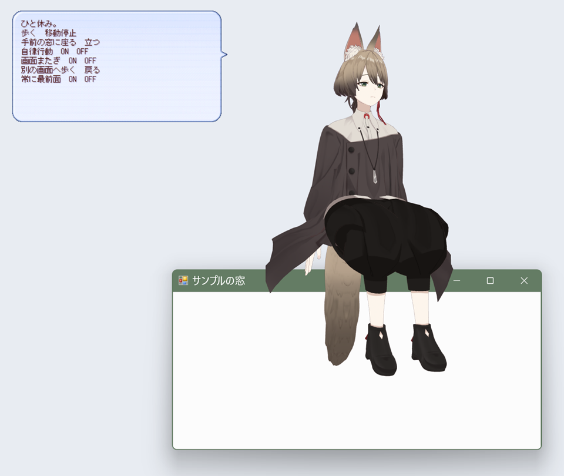

# ukagaka-3d-shell

伺か（SSP）のゴーストを、MMD の PMX モデルで 3D 表示するためのランタイムです。
デスクトップに透過ウィンドウで 3D キャラクターを表示し、SSP の会話・メニューと連動させます。
無料・非営利のオープンソースプロジェクトで、ライセンスは MIT です。

> **v0.1.0-beta（ベータ版）です。** 作者の環境で確認した範囲で公開しています。
> 確認できていない環境や操作があります。下の「対応状況」と「既知の制限」を読んでからお使いください。



<sub>サンプルゴーストを SSP で動かした画面。モデル：CG-CA Uka (c) 2023-2024 by Nagoya Institute of Technology, Moonshot R&D Goal 1 Avatar Symbiotic Society（CC BY 4.0）</sub>

## 主な機能

- PMX 2.0／2.1 のモデルを、背景が透けるウィンドウで表示（モデルのない部分はクリックが下の窓に届きます）
- VMD モーション、表情（モーフ）、IK、MMD の物理演算（Bullet）
- SSP との連携：YAYA 6 の辞書から SAORI 経由でモーション・表情・移動を操作
- モデルのクリック・ダブルクリック・なで・長押しドラッグを、部位名つきのイベントとしてゴーストに通知
- デスクトップを歩く、手前の窓の上端に座る（窓の移動に追従）、自律行動、画面をまたぐ移動
- モデルの脚と腕を測って、待機・歩行・着席・つまみのモーションを自動で作るツール（`uka3d_motiongen`）

## 対応状況

記号：✅ 確認済み（実際に動かして確認）／🟡 実装済み・未確認／❌ 未対応

| 項目 | 状態 | 補足 |
|---|---|---|
| PMX モデルの表示・VMD・表情・物理 | ✅ | CG-CA Uka、CG-CA Gene、ユーザー提供のモデル 5 体（同じ骨格）で確認。**すべての PMX での動作は保証しません** |
| BDEF1／BDEF2／BDEF4／SDEF／QDEF の頂点変形 | ✅ | libmmd の計算結果と一致することを自動テストで確認。SDEF／QDEF は、実モデルの頂点を変換したデータで確認 |
| SSP と YAYA 6 での起動・会話・メニュー・終了 | ✅ | SSP 2.9.33、YAYA 6.8.3 |
| NAR のインストール | ✅ | プロファイルを空にした SSP で確認 |
| クリック・ダブルクリック・なで・長押しドラッグ | ✅（合成入力） | OS の入力経路を通した**自動操作**で確認。**人の手による操作感は未確認** |
| 歩行・窓への着席・窓の移動への追従 | ✅ | 着席したまま対象の窓を動かしても追従 |
| 2 画面（拡大率 150% と 125%） | ✅ | 左右に並べた 1 組の配置だけで確認。上下の配置、隙間のある配置、3 画面以上は未確認 |
| 30／60／120fps、長時間常駐（60 分） | ✅ | Intel UHD Graphics（内蔵 GPU）の 1 台で確認 |
| 里々（Satori）からの利用 | 🟡 | SAORI としては読み込めるはずですが、未確認。里々の辞書を YAYA に変換するツールはあります |
| Windows 10、ほかの GPU、VC++ ランタイムのない Windows | 🟡 | 作者の Windows 11 の 1 台でのみ確認。ランタイムは静的リンクで、依存 DLL は OS 標準のものだけです |
| 高 DPI（125%／150% 以外） | 🟡 | DPI ごとの拡大縮小は実装済み |
| PMD、VRM、ソフトボディ | ❌ | VRM は[調査のみ](docs/vrm-investigation.md) |
| Uka3D 互換、視線追従、リップシンク | ❌ | |

細かい検証結果と未確認の項目は [docs/progress.md](docs/progress.md) にあります。

## 動作環境

- Windows 10／11（64 ビット）。確認は Windows 11 のみ
- SSP（2.9.33 で確認）
- Direct3D 11（機能レベル 11.0 以上）に対応した GPU。使えない場合はソフトウェア描画に切り替わります
- 追加のインストールは不要です（VC++ 再頒布可能パッケージも不要）

## インストールとサンプルゴースト

1. SSP を用意します（[SSP の配布ページ](https://ssp.shillest.net/)）。
2. リリースの `ukagaka3d-<バージョン>-sample-uka.nar` を、起動中の SSP にドラッグ＆ドロップしてインストールします。
3. SSP の「ゴースト切り替え」で `ukagaka3d sample` を選びます。3D のうかと「こんにちは。」のバルーンが出ます。
4. キャラクターをダブルクリックするとメニューが出ます。頭のクリック、頭をなでる（ボタンを押さずに往復）、長押しドラッグに反応します。「デスクトップ行動」から歩行や窓への着席を試せます。
5. SSP のメニューは、キャラクターを右クリックすると開きます。

サンプルのメモリ使用量は約 430MB です（内蔵 GPU、テクスチャを 2048×2048 に縮小した状態）。

## 自分のゴーストで使う（PMX／VMD）

リリースの `ukagaka3d-<バージョン>-ghost-template.zip` に、モデルを除いたゴースト一式、作者向けマニュアル、API リファレンスが入っています。

1. PMX とテクスチャを `ghost/master/3d/model/user/` に置き、`ukagaka3d.json` の `model` を書き換えます。
2. `uka3d_motiongen.exe` でモデルに合わせた待機・歩行・着席・つまみの VMD を作ります。手持ちの VMD も、ボーン名が合えば使えます。
3. `hit-regions.json` で部位の当たり判定を、`ghost.dic` で会話を作ります。

**モデルとモーションの利用規約（再配布、改変、ゴーストへの組み込みの可否）は、必ず配布元で確認してください。**

### ゴースト作者向けマニュアル

1. [最初の 3D ゴーストを起動する](docs/author-guide/00-getting-started.md)
2. [PMX・テクスチャとモデル差し替え](docs/author-guide/01-models.md)
3. [VMD モーションと表情](docs/author-guide/02-motions.md)
4. [クリック・なで・ドラッグ](docs/author-guide/03-interactions.md)
5. [YAYA 6・里々と SAORI](docs/author-guide/04-shiori-integration.md)
6. [デスクトップ歩行・着席](docs/author-guide/05-desktop-behavior.md)
7. [NAR の組み立てと配布](docs/author-guide/06-distribution.md)
8. [トラブルシューティング](docs/author-guide/07-troubleshooting.md)

API リファレンス：[SAORI と IPC](docs/ipc-protocol.md) · [デスクトップ行動](docs/desktop-behavior.md) · [3D 入力イベント](docs/interaction-transport.md)

### YAYA 6 と里々

- **YAYA 6**：サンプルとテンプレートは YAYA 6 で動いています。辞書からは `_ok = Play3DMotion("greet", 0, "idle")`、`_ok = Set3DMorph("笑い", 1.0)` のように操作します。
- **里々**：里々のゴーストから SAORI として呼ぶ方法は、まだ確認していません。里々の辞書を YAYA 6 に変換するツール（`tools/satori2yaya.py`、[説明](docs/satori-to-yaya.md)）があります。

## 既知の制限（ベータ版）

- 動作を確認したモデルは限られています。ボーン名が MMD の標準と違うモデル、大きなマントに「全物理」を設定したモデルなどでは、動きや物理が不自然になることがあります。
- 人の手でマウスを操作したときの、なでの感触や反応の速さは未確認です。
- メモリは使うモデルのテクスチャに比例します。4096×4096 のテクスチャを多く使うモデルでは 1GB を超えることがあります。
- 内蔵 GPU では、120fps で 3D 処理の負荷が 25% 前後になります。既定の上限は 60fps です。
- 自動生成の歩行モーションは、サンプルと同じウィンドウの大きさと、画面の拡大率に合わせた速度のときに足が滑らないように作られています。
- SSP に `--ghost` でフォルダを指定して起動したとき、1 度だけ別のゴーストが起動したことがあります（その後は再現していません）。

## 不具合の報告

[GitHub の Issues](https://github.com/koziyagoukei/Uka-3D-Shell/issues) に、次の内容を添えて報告してください。

- Windows のバージョン、GPU、画面の拡大率と画面の数
- SSP と SHIORI（YAYA など）のバージョン
- ゴーストの `ghost/master/ukagaka3d_runtime.log` と `ukagaka3d_saori.log`
- 使ったモデルが公開されているものなら、その名前と配布元（モデルのファイルそのものは添付しないでください）

## ライセンスとクレジット

- ukagaka-3d-shell 本体：[MIT License](LICENSE)
- 使用しているライブラリ：libmmd（MIT）、Bullet Physics（zlib）、nlohmann/json（MIT）、stb（MIT）。全文は [THIRD_PARTY_NOTICES.md](THIRD_PARTY_NOTICES.md)
- サンプルゴーストの YAYA：BSD 3-Clause License（YAYA の配布物のライセンス文書を同梱）
- サンプルゴーストのモデル：**CG-CA Uka (c) 2023-2024 by Nagoya Institute of Technology, Moonshot R&D Goal 1 Avatar Symbiotic Society**、[CC BY 4.0](https://creativecommons.org/licenses/by/4.0/deed.ja)、[公式リポジトリ](https://github.com/mmdagent-ex/uka)。テクスチャを縮小しています。公式の利用ガイドラインに従ってください
- サンプルのモーションは、このプロジェクトのプログラムで作ったオリジナルです

このプロジェクトは非公式のもので、うかの公式、SSP、YAYA の各開発者とは関係ありません。名前の似ている先行の SAORI「Uka3D」（yasi 氏）とも別のプロジェクトで、コードやバイナリは使っていません。
リポジトリには第三者の MMD モデル・モーション・テクスチャを含めていません（README のスクリーンショット `docs/images/screenshot-uka.png` に写っている Uka の描画を除く。CC BY 4.0）。サンプルのモデルは、組み立て時に公式リポジトリから取得します。

## ソースからのビルド（開発者向け）

必要なもの：Visual Studio 2022 以降または Build Tools（C++ によるデスクトップ開発、Windows SDK）、Git、CMake 3.25 以降と Ninja（Visual Studio 同梱のもので可）

```powershell
# x64 と x86 の Debug／Release をビルドし、自動テストを実行する
powershell -ExecutionPolicy Bypass -File scripts\build.ps1 -Test
# サンプルゴーストを組み立てる（YAYA 6 の yaya.dll と LICENSE を用意しておく）
powershell -ExecutionPolicy Bypass -File scripts\package-ghost.ps1 -YayaDll C:\path\to\yaya.dll -Nar
# 配布ファイル一式（NAR、ランタイム、テンプレート、SHA-256）を作る
powershell -ExecutionPolicy Bypass -File scripts\make-release.ps1 -YayaDll C:\path\to\yaya.dll -Label 0.1.0-beta
```

詳しくは [docs/build.md](docs/build.md)、設計は [docs/architecture.md](docs/architecture.md)、ランタイム単体のコマンドラインは `ukagaka3d.exe --help` を参照してください。

```text
SSP（32bit）─ SHIORI（YAYA 6）─ ukagaka3d_saori.dll（x86）══ 名前付きパイプ（JSON）══ ukagaka3d.exe（x64）
```

| フォルダ | 内容 |
|---|---|
| `src/` | ランタイム（描画、アニメーション、デスクトップ行動、入力）、IPC、SAORI |
| `shaders/` | MMD 風シェーダー |
| `samples/yaya-ghost/` | サンプルゴーストのソース（モデルと yaya.dll は含めない） |
| `tools/` | モーション生成、テクスチャ縮小、PMX 情報表示、里々→YAYA 変換、テスト用データの生成 |
| `tests/` | 自動テスト |
| `scripts/` | ビルド、サンプルの組み立て、配布ファイルの作成 |
| `docs/` | マニュアル、仕様、設計、検証結果 |
